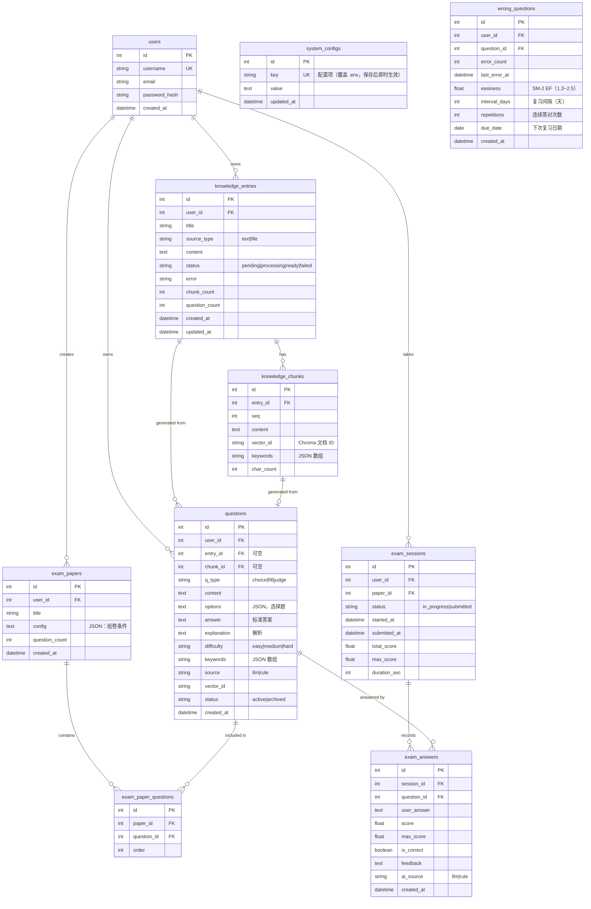
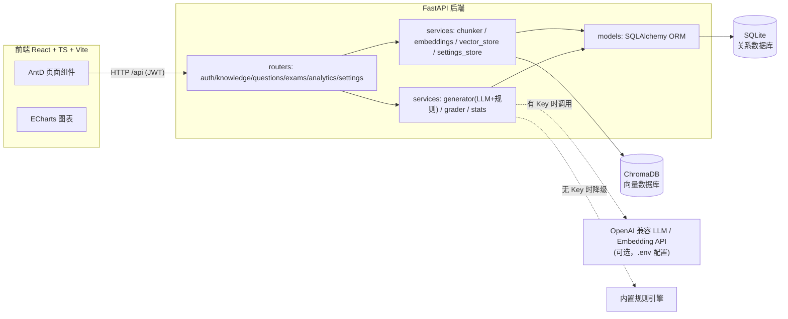

# 面试题录入训练系统 — 需求分析与架构设计

> 版本：v1.0 | 日期：2026-10-23 | 状态：已评审，进入实现

---

## 1. 背景与目标

### 1.1 背景
开发者平时积累大量技术资料（笔记、文档、源码片段），这些知识散落在各处，难以转化为"可练习、可评分、可复盘"的面试训练资产。常见痛点：

1. 资料看完就忘，缺少主动回忆（Active Recall）环节；
2. 手工整理面试题耗时，且没有标准答案与解析；
3. 盲目刷题，不知道自己哪种题型弱、哪道题总错；
4. 缺少数据反馈，训练没有闭环。

### 1.2 产品目标
打造一站式面试训练闭环：

```
资料录入 → AI 处理分析 → AI 生成题目 → 随机组卷 → 在线答题 → AI 评分 → 数据复盘
```

**成功标准（可验证）**：
- 录入一份 1000 字技术资料后，**5 分钟内**可完成"生成题目 → 组卷 → 提交 → 拿到评分与解析"全流程；
- 系统在**无 LLM API Key** 的环境下可完整演示（内置规则引擎降级）；
- 配置任意 OpenAI 兼容 API（DeepSeek / 通义千问 / Moonshot / OpenAI）后，一键切换到真实 AI 出题与评分；
- 数据全部落盘：关系型数据库（SQLite）+ 向量数据库（ChromaDB）。

### 1.3 目标用户
- **主用户**：正在求职的开发者（本人），录入自己的技术笔记，反复训练并复盘。

---

## 2. 用户故事

| 编号 | 角色 | 故事 |
|---|---|---|
| US-1 | 求职者 | 我可以粘贴文本或上传 .txt/.md 文件录入知识库，系统自动分块、提取关键词、向量化 |
| US-2 | 求职者 | 我可以对某条资料触发"AI 出题"，选择题型（单选/填空/判断）、数量、难度，系统生成带标准答案和解析的题目 |
| US-3 | 求职者 | 我可以在题库中按题型/难度/来源筛选浏览题目 |
| US-4 | 求职者 | 我可以按"数量 + 题型组合 + 难度 + 来源"从题库**随机抽取**生成一份考卷 |
| US-5 | 求职者 | 我可以逐题在线作答（单选/判断用选项、填空用输入框），中途退出后可继续同一场考试 |
| US-6 | 求职者 | 提交后系统对每个答案 AI 评分：客观题精确判分，填空题语义相似度判分，并给出逐题反馈与总分 |
| US-7 | 求职者 | 我在**题目分析平台**看到题目总量、类型/难度分布、各资料收录量、题目正确率排行（找出"好题"与"坏题"） |
| US-8 | 求职者 | 我在**做题分析平台**看到我的考试次数、平均得分率、各题型正确率、每日成绩趋势、最近考试记录 |

---

## 3. 功能需求

### FR-1 知识库录入
- 文本粘贴录入（标题 + 正文，标题缺省时取正文首行前 30 字）；
- 文件上传（.txt / .md，UTF-8），自动识别标题；
- 录入后自动进入处理流程，状态机：`pending → processing → ready / failed`；
- 支持删除条目（级联删除其 chunks、题目、向量）。

### FR-2 内容分析与处理（录入后自动执行）
1. **分块（Chunking）**：按段落切分，超长块按中文句读（。！？；）二次切分，目标 300~500 字/块，块间保留上下文；
2. **关键词提取**：基于语料词频（CJK n-gram + 英文词，停用词过滤）提取每块 Top 关键词；
3. **向量化**：将每块文本嵌入为向量（有 API 时用 Embedding 模型，否则用内置确定性向量）；
4. **入向量库**：ChromaDB 持久化，元数据携带 entry_id / chunk_id / seq，支持语义检索；
5. 统计信息：块数、字数、预计阅读时长。

### FR-3 AI 出题
- 输入：来源条目（可选，缺省为全库）、题型多选（choice / fill / judge）、每题型数量、难度（easy / medium / hard，缺省混合）；
- 输出：题目含 `content / options（选择题）/ answer 标准答案 / explanation 解析 / difficulty / keywords`；
- **质量保障**：
  - 生成结果做 JSON 解析修复 + 失败重试（最多 2 次）；
  - 入库前**向量去重**：与题库已有题目向量相似度 ≥ 0.95 则舍弃并重新抽取素材；
  - 每题记录生成来源标记 `source = llm | rule`（AI 生成 / 规则生成），前端展示徽标；
- 无 LLM Key 时由**内置规则引擎**生成（术语选择题 /  masking 填空题 / 否定变换判断题），保证演示可用。

### FR-4 题库管理
- 列表分页、按题型/难度/来源条目/关键词筛选；
- 题目详情（含解析、关键词、来源徽标）；
- 删除单题。

### FR-5 随机组卷
- 输入：考卷标题（可选，自动生成）、题目数量、题型组合、难度（可选）、来源条目（可选）；
- 从符合条件的题库中**随机不重复抽取**；
- 库存不足时返回明确错误（"符合条件的题目仅 X 道，请减少数量或放宽条件"），不静默凑数。

### FR-6 在线考试
- 生成考卷后可"开始考试"，创建会话（session）；
- 同一用户对同一考卷的未提交会话可**断点续考**；
- 逐题作答：单选/判断渲染为单选组件，填空渲染为输入框；
- 提交后会话锁定，答案不可修改。

### FR-7 AI 评分
- **单选题**：选项字母精确匹配；
- **判断题**：语义归一化匹配（正确/对/√/是/true ↔ 错误/错/×/否/false）；
- **填空题**：考生答案与标准答案的字符 n-gram TF-IDF 余弦相似度：
  - ≥ 0.80 得满分；≥ 0.50 得半分；否则 0 分；
  - 有 LLM 时优先由 LLM 评判（0~1 得分 + 一句点评），LLM 失败自动降级规则评分；
- 输出：逐题 `score / max_score / is_correct / feedback`，以及会话总分、总得分率、正确题数、用时；
- 判定口径：`is_correct = score ≥ 60% × max_score`（填空题半分不记为正确）。

### FR-8 题目分析平台（对"题"分析）
- 统计卡：题目总量、AI 生成占比、已产生答题数据题数；
- 饼图：题型分布；柱状图：难度分布；横向柱状图：收录量 Top 10 资料；
- 表格：答题正确率最低 10 题（定位烂题/过难题，需修订）。

### FR-9 做题分析平台（对"人"分析）
- 统计卡：考试场次、平均得分率、累计答题数、综合正确率、最佳成绩；
- 折线图：近 30 天每日成绩趋势（考试场次 + 平均得分率）；
- 饼图：题型作答分布；柱状图：各题型正确率（定位薄弱题型）；
- 表格：最近考试记录（考卷名、得分、得分率、用时、时间）。

### FR-10 账号体系
- 注册 / 登录，JWT 无状态认证（默认 24h）；
- 所有业务接口按 `user_id` 数据隔离；
- 密码 bcrypt 哈希存储；
- **Web 修改密码**（验证原密码）。

### FR-11 系统配置页（保存后即时生效，无需重启）
- LLM 配置：Base URL / API Key（脱敏展示）/ 模型 / 超时；
- Embedding 配置（可选，留空使用内置确定性向量）；
- **测试连接**：用当前表单值（含未保存）发起最小真实请求，返回耗时与结果；
- 恢复默认：清除全部覆盖回退 `.env`；
- 配置优先级：`system_configs 表 > .env > 代码默认值`。

### FR-12 错题本与间隔重复（SM-2）
- 考试提交后自动收集错题（得分率 < 60% 判定为错）；
- SM-2 算法排期：答对按 1 天 → 6 天 → 间隔×EF 递增，答错重置；EF 动态调整（clamp 1.3~2.5）；
- 连续 3 次复习答对且间隔 ≥ 21 天视为掌握，自动移出；支持手动标记掌握/移出；
- 「开始复习」从到期错题随机组复习卷，复用考试/提交链路（session.mode=review）；
- 统计：错题总数、今日待复习、已逾期、未来 7 天。

### FR-13 出题审核流（人机协同）
- AI/规则生成的题目默认进入**待审核**（pending），审核通过（approved）后才进入组卷池；
- 审核操作：单题通过/拒绝、**编辑后通过**（修正题干/选项/答案/解析，带合法性校验）、按资料批量通过；
- 题库按审核状态分 Tab（已通过/待审核/已拒绝）；侧边栏「题目审核」带待审数徽标；
- 被考卷引用的题目禁止删除，保证历史成绩完整。

### FR-14 多格式资料导入
- 文件上传：`.txt` / `.md` / `.pdf`（pypdf 提取文本层，扫描件明确报错，不做 OCR）/ `.docx`（python-docx 提取段落与表格），≤10MB；
- 网页链接录入：httpx 抓取 + readability-lxml 提取正文（去导航/广告/页脚噪声），需登录或纯动态渲染页面会明确提示失败；
- URL 抓取直连目标地址（不经代理），超时 30s，重定向上限 5 次；
- 导入后统一走现有处理流水线（分块→关键词→向量化）。

---

## 4. 非功能需求（NFR）

| 类别 | 要求 |
|---|---|
| 可运行性 | 零配置启动：无 API Key 自动进入演示模式（规则引擎出题/评分），UI 显著位置提示 |
| 可切换性 | `.env` 配置 `LLM_BASE_URL/LLM_API_KEY/LLM_MODEL`，兼容任何 OpenAI 协议服务商 |
| 持久化 | SQLite（`data/interview_trainer.db`）+ ChromaDB（`data/chroma/`），重启不丢数据 |
| 安全 | bcrypt 密码哈希、JWT 鉴权、ORM 参数化查询、文件上传限制 5MB 且仅 .txt/.md |
| 性能（演示级） | 单条资料处理 < 3s（离线向量）；LLM 出题 10 题 < 60s（取决于模型）；统计接口 < 200ms |
| 可维护性 | 分层清晰（router → service → model）；核心纯函数（分块/相似度/评分）单测覆盖 |
| 兼容性 | Python ≥ 3.10；前端现代浏览器（Chrome/Edge 最新两个大版本） |

---

## 5. 领域模型（ER 图）



---

## 6. 系统架构



**分层职责**：
- `routers/`：HTTP 协议层，参数校验（Pydantic），不做业务；
- `services/`：业务核心——分块、向量化、出题、评分、统计，纯函数可单测；
- `models/`：SQLAlchemy ORM，唯一数据访问入口。

---

## 7. 技术选型与对比

### 7.1 后端框架

| 候选 | 优势 | 劣势 | 结论 |
|---|---|---|---|
| **FastAPI** | 异步生态好、Pydantic 校验强、自动 Swagger 文档、Python AI 生态最近 | 同步场景需注意线程池 | ✅ 选它：出题/评分重度依赖 Python AI 生态（numpy、chromadb），接口自动生成文档利于演示 |
| Flask | 轻量 | 需手动集成校验/文档，现代项目偏弱 | ❌ |
| NestJS | TS 全栈一致 | 用户虽熟悉，但 Python 侧 AI 库（chromadb/numpy）无法直接复用 | ❌ |

### 7.2 关系型数据库

| 候选 | 优势 | 劣势 | 结论 |
|---|---|---|---|
| **SQLite** | 零部署、文件级持久化、演示/单机最佳 | 高并发写弱 | ✅ 选它：单用户演示系统，ORM 建模保证可平滑迁移 PostgreSQL |
| PostgreSQL | 生产强 | 需装服务，增加环境负担 | ❌（列入演进路线：SQLAlchemy 已屏蔽差异，改 `DATABASE_URL` 即可切换） |

### 7.3 向量数据库

| 候选 | 优势 | 劣势 | 结论 |
|---|---|---|---|
| **ChromaDB** | 嵌入式零部署、Python 一等公民、持久化目录、AI 应用圈认知度高 | 海量规模性能一般 | ✅ 选它：嵌入式 + 持久化 + 面试作品集辨识度 |
| Qdrant | 性能强 | 需 Docker/服务端，本地模式 API 稳定性一般 | ❌ |
| pgvector | 与 PG 一体 | 依赖 PostgreSQL 部署 | ❌（演进路线候选） |

### 7.4 LLM 接入

| 候选 | 优势 | 劣势 | 结论 |
|---|---|---|---|
| **OpenAI 兼容协议直连** | DeepSeek/通义/Moonshot/OpenAI 一套代码全兼容，只配 `.env` | 需自己处理重试与 JSON 修复 | ✅ 选它：成本可控、切换自由 |
| LangChain | 抽象全 | 框架锁定、调试链路长，杀鸡用牛刀 | ❌ |
| 纯本地小模型 | 完全离线 | 下载大、硬件要求高 | ❌（降级方案用规则引擎代替，保证演示） |

### 7.5 前端

| 候选 | 优势 | 结论 |
|---|---|---|
| **React 18 + TS + Vite + AntD 5 + ECharts** | 中后台页面效率高、图表能力强、生态成熟 | ✅ |
| Vue3 + Element Plus | 同样成熟，非用户主力栈 | ❌ |
| Next.js | SSR 无必要，纯 SPA 更轻 | ❌ |

### 7.6 评分算法
- 客观题（选择/判断）：精确/归一化匹配，**不需要 LLM**，零成本且 100% 可靠；
- 填空题：字符 n-gram TF-IDF 余弦相似度（离线、确定性、中文友好）→ 有 LLM 时升级为 LLM 评判；
- 选择理由：主观题评分是全系统唯一"不确定"环节，双通道设计保证永远可用。

---

## 8. 核心流程

### 8.1 录入与处理流程
```
用户提交文本/文件
  → 创建 entry(status=processing)
  → chunker 分块（段落→句读二次切分，300~500字）
  → 每块提取关键词（词频+停用词）
  → embeddings 向量化（API 或 内置确定性向量）
  → upsert ChromaDB collection=kb_chunks
  → 回写 chunk.vector_id，entry.status=ready
```

### 8.2 AI 出题流程
```
请求（entry_id?, types, count_per_type, difficulty）
  → 选取素材 chunks（指定条目 or 全库采样）
  → 对每块调用 LLM（或规则引擎）生成题目（严格 JSON）
  → 解析失败 → 修复重试（≤2 次）→ 仍失败跳过该块
  → 向量去重（与 questions collection 相似度 ≥0.95 舍弃）
  → 入库 + 入向量库
  → 返回生成结果（含 source 标记）
```

### 8.3 考试与评分流程
```
组卷（随机抽样）→ 开始考试（session）→ 逐题作答
  → 提交：客观题精确匹配；填空题 LLM/规则语义评分
  → 汇总总分/得分率/用时，写 exam_answers
  → 结果页逐题反馈 + 解析
  → 数据流入两张分析看板
```

---

## 9. API 契约（前后端对齐的唯一事实源）

**通用约定**：
- Base URL：`/api`；认证：请求头 `Authorization: Bearer <token>`；
- 成功返回业务 JSON；错误统一 `{ "detail": "人类可读信息" }`（HTTP 4xx/5xx）；
- 分页统一：`{ "items": [...], "total": 12, "page": 1, "size": 10 }`；
- 时间格式 ISO 8601（`2026-10-23T12:00:00`）。

### 9.1 认证

| 方法 | 路径 | 请求体 | 响应 |
|---|---|---|---|
| POST | `/api/auth/register` | `{username, password, email?}` | `{id, username, email, created_at}` |
| POST | `/api/auth/login` | `{username, password}` | `{access_token, token_type:"bearer", user:{id, username, email}}` |
| GET | `/api/auth/me` | - | `{id, username, email, created_at}` |

### 9.2 知识库

| 方法 | 路径 | 说明 |
|---|---|---|
| POST | `/api/knowledge/entries` | 文本录入 `{title?, content}`，同步触发处理 |
| POST | `/api/knowledge/entries/upload` | multipart 上传 `file`(.txt/.md) + `title?` |
| GET | `/api/knowledge/entries?page&size&status&keyword` | 分页列表 |
| GET | `/api/knowledge/entries/{id}` | 详情（含 chunks） |
| POST | `/api/knowledge/entries/{id}/reprocess` | 重新处理 |
| DELETE | `/api/knowledge/entries/{id}` | 删除（级联） |
| POST | `/api/knowledge/search` | 语义检索 `{query, top_k=5}` |
| GET | `/api/knowledge/stats/overview` | 总览统计 |

**对象结构**：

```jsonc
// KnowledgeEntry（列表项/详情公共字段）
{
  "id": 1, "title": "Redis 核心知识笔记", "source_type": "text",
  "status": "ready",              // pending|processing|ready|failed
  "error": null,
  "chunk_count": 6, "question_count": 9, "char_count": 1580,
  "created_at": "2026-10-23T12:00:00", "updated_at": "2026-10-23T12:00:10"
}

// GET /api/knowledge/entries/{id}
{
  "entry": { ...KnowledgeEntry },
  "chunks": [
    { "id": 1, "seq": 0, "content": "...", "char_count": 320, "keywords": ["缓存", "穿透"] }
  ]
}

// POST /api/knowledge/search  请求 {"query": "缓存穿透怎么解决", "top_k": 5}
{
  "results": [
    { "chunk_id": 1, "entry_id": 1, "entry_title": "Redis 核心知识笔记",
      "seq": 0, "content": "...", "score": 0.87 }
  ]
}

// GET /api/knowledge/stats/overview
{ "entry_count": 5, "ready_count": 5, "processing_count": 0,
  "chunk_count": 30, "vector_count": 30 }
```

### 9.3 题库与出题

| 方法 | 路径 | 说明 |
|---|---|---|
| POST | `/api/questions/generate` | AI 出题 `{entry_id?, types:["choice"], count_per_type:3, difficulty?}` |
| GET | `/api/questions?page&size&q_type&difficulty&entry_id&keyword` | 分页筛选 |
| GET | `/api/questions/{id}` | 详情 |
| DELETE | `/api/questions/{id}` | 删除 |
| GET | `/api/questions/stats/overview` | 题库统计 |

```jsonc
// Question
{
  "id": 1, "q_type": "choice",           // choice|fill|judge
  "content": "关于 Redis 缓存穿透，下列说法正确的是？",
  "options": ["A. 缓存空值并设置较短 TTL", "B. ...", "C. ...", "D. ..."],  // 选择题，其余为 null
  "answer": "A",
  "explanation": "缓存穿透指查询不存在的数据...",
  "difficulty": "medium",                 // easy|medium|hard
  "keywords": ["缓存穿透", "布隆过滤器"],
  "entry_id": 1, "entry_title": "Redis 核心知识笔记",
  "source": "rule",                       // llm|rule（AI 生成/规则生成）
  "created_at": "2026-10-23T12:00:00"
}

// POST /api/questions/generate 请求
{ "entry_id": 1, "types": ["choice", "fill", "judge"], "count_per_type": 3, "difficulty": "medium" }
// 响应
{ "created": [ ...Question ], "created_count": 9, "skipped_count": 0,
  "mode": "rule",                          // rule|llm 当前生成模式
  "message": "已生成 9 道题（规则引擎模式）" }

// GET /api/questions/stats/overview
{ "total": 42, "llm_count": 12, "rule_count": 30,
  "by_type": { "choice": 18, "fill": 12, "judge": 12 },
  "by_difficulty": { "easy": 10, "medium": 20, "hard": 12 },
  "by_entry": [ { "entry_id": 1, "title": "Redis 核心知识笔记", "count": 15 } ] }
```

### 9.4 考试

| 方法 | 路径 | 说明 |
|---|---|---|
| POST | `/api/exams/generate` | 随机组卷 `{title?, count, types[], difficulty?, entry_ids?}` |
| GET | `/api/exams?page&size` | 我的考卷列表 |
| GET | `/api/exams/{id}` | 考卷详情（题目不含答案） |
| POST | `/api/exams/{id}/start` | 开始/续考 → 会话（返回已保存的作答草稿） |
| POST | `/api/exams/sessions/{id}/save` | 保存作答草稿（断点续考，仅进行中会话）`{answers:[{question_id, answer}]}` |
| POST | `/api/exams/sessions/{id}/submit` | 提交并评分 `{answers:[{question_id, answer}]}` |
| GET | `/api/exams/sessions/{id}` | 成绩详情 |
| GET | `/api/exams/sessions?page&size` | 历史考试 |

```jsonc
// ExamPaper（列表项）
{ "id": 1, "title": "随机考卷 · 单选5+判断5", "question_count": 10,
  "config": { "count": 10, "types": ["choice","judge"], "difficulty": null, "entry_ids": null },
  "created_at": "...",
  "latest_session": { "id": 3, "status": "submitted", "total_score": 75, "max_score": 100,
                      "submitted_at": "..." } }   // 无则为 null

// GET /api/exams/{id}
{ "paper": { ...ExamPaper }, "questions": [
  { "id": 10, "q_type": "choice", "content": "...", "options": [...], "difficulty": "medium" }
] }

// ExamSession
{ "id": 3, "paper_id": 1, "status": "in_progress", "started_at": "...", "submitted_at": null }

// POST /api/exams/{id}/start 响应（answers 为已保存草稿，支持断点续考）
{ "session": { ...ExamSession },
  "questions": [ ...同考卷详情 ],
  "answers": [ { "question_id": 10, "user_answer": "布隆过滤器" } ] }

// POST submit 响应
{ "session_id": 3, "total_score": 75.0, "max_score": 100.0, "score_rate": 0.75,
  "correct_count": 7, "question_count": 10, "duration_sec": 320,
  "results": [
    { "question_id": 10, "q_type": "choice", "content": "...", "options": [...],
      "answer": "A", "user_answer": "A", "score": 10, "max_score": 10,
      "is_correct": true, "feedback": "回答正确", "explanation": "...", "ai_source": "rule" }
  ] }

// GET /api/exams/sessions 列表项
{ "id": 3, "paper_title": "随机考卷 · 单选5+判断5", "total_score": 75.0, "max_score": 100.0,
  "score_rate": 0.75, "correct_count": 7, "question_count": 10,
  "duration_sec": 320, "submitted_at": "..." }
```

### 9.5 分析看板

| 方法 | 路径 | 说明 |
|---|---|---|
| GET | `/api/analytics/questions/overview` | 题目总览（总量/类型/难度/Top条目） |
| GET | `/api/analytics/questions/accuracy?limit=10` | 正确率最低 N 题 |
| GET | `/api/analytics/practice/overview` | 个人做题总览 |
| GET | `/api/analytics/practice/trend?days=30` | 每日趋势 |
| GET | `/api/analytics/practice/by-type` | 分题型正确率 |
| GET | `/api/analytics/practice/recent?limit=10` | 最近考试 |

```jsonc
// GET /api/analytics/questions/overview
{ "total": 42, "llm_count": 12, "rule_count": 30, "answered_count": 20,
  "by_type": [ {"key":"choice","count":18}, {"key":"fill","count":12}, {"key":"judge","count":12} ],
  "by_difficulty": [ {"key":"easy","count":10}, {"key":"medium","count":20}, {"key":"hard","count":12} ],
  "by_entry": [ {"entry_id":1,"title":"Redis 核心知识笔记","count":15} ] }   // 按 count 倒序

// GET /api/analytics/questions/accuracy
{ "items": [
  { "question_id": 10, "content": "关于 Redis 缓存穿透...", "q_type": "choice",
    "entry_title": "Redis 核心知识笔记", "answered_count": 3, "correct_count": 0, "accuracy": 0.0 }
] }

// GET /api/analytics/practice/overview
{ "session_count": 8, "submitted_count": 6, "avg_score_rate": 0.72,
  "total_answered": 60, "total_correct": 45, "overall_accuracy": 0.75, "best_score_rate": 0.9 }

// GET /api/analytics/practice/trend?days=30
{ "items": [ {"date":"2026-10-20","session_count":2,"avg_score_rate":0.8,"answered":20,"correct":16} ] }

// GET /api/analytics/practice/by-type
{ "items": [ {"q_type":"choice","answered":20,"correct":18,"accuracy":0.9,"avg_score":8.5} ] }

// GET /api/analytics/practice/recent
{ "items": [ ...同 sessions 列表项 ] }
```

### 9.6 系统配置

| 方法 | 路径 | 说明 |
|---|---|---|
| GET | `/api/settings` | 当前配置（API Key 脱敏）+ 生效状态 |
| PUT | `/api/settings` | 保存配置（字段缺省=不修改；空串=清空；即时生效） |
| POST | `/api/settings/reset` | 清除全部覆盖，回退 .env |
| POST | `/api/settings/test` | 测试连接 `{target:"llm"\|"embedding", ...表单值}` → `{ok, latency_ms, detail, error}` |
| POST | `/api/settings/password` | 修改密码 `{old_password, new_password}` |

```jsonc
// GET /api/settings
{ "llm_base_url": "", "llm_api_key_masked": "", "llm_api_key_set": false,
  "llm_model": "deepseek-chat", "llm_timeout_seconds": 120,
  "embedding_base_url": "", "embedding_api_key_masked": "", "embedding_api_key_set": false,
  "embedding_model": "BAAI/bge-m3",
  "llm_enabled": false,          // false=演示模式，true=AI 模式
  "embedding_mode": "local" }    // api | local
```

### 9.7 错题本

| 方法 | 路径 | 说明 |
|---|---|---|
| GET | `/api/wrong-questions?page&size&q_type&only_due` | 错题列表（含 SM-2 排期） |
| GET | `/api/wrong-questions/stats` | 总数/今日待复习/逾期/未来7天 |
| POST | `/api/wrong-questions/review/generate` | 从到期错题组复习卷 `{count}` |
| POST | `/api/wrong-questions/{id}/master` | 标记掌握（移出） |
| DELETE | `/api/wrong-questions/{id}` | 移出错题本 |

```jsonc
// WrongQuestionItem（列表项）
{ "id": 1, "question_id": 12, "content": "……", "q_type": "choice", "options": [...],
  "answer": "A", "explanation": "……", "difficulty": "medium",
  "entry_title": "Redis 核心知识笔记", "error_count": 2,
  "interval_days": 6, "repetitions": 1,
  "due_date": "2026-10-30", "days_until_due": 6, "last_error_at": "2026-10-24T…" }
```

---

## 10. 目录结构

```
interview-trainer/
├── README.md                        # 快速开始
├── docs/
│   └── 01-需求分析与架构设计.md      # 本文档
├── backend/
│   ├── requirements.txt
│   ├── .env.example                 # LLM/Embedding/密钥配置样例
│   ├── seed.py                      # 演示数据种子（demo/demo123）
│   ├── app/
│   │   ├── main.py                  # FastAPI 入口、CORS、路由挂载
│   │   ├── config.py                # pydantic-settings 配置
│   │   ├── database.py              # SQLAlchemy engine/session
│   │   ├── models.py                # ORM 模型
│   │   ├── schemas.py               # Pydantic 出入参
│   │   ├── security.py              # bcrypt + JWT
│   │   ├── dependencies.py          # 当前用户注入
│   │   ├── routers/                 # auth/knowledge/questions/exams/analytics/settings/wrong-questions
│   │   └── services/
│   │       ├── text_utils.py        # n-gram/停用词/相似度（纯函数）
│   │       ├── chunker.py           # 分块 + 关键词
│   │       ├── embeddings.py        # 向量化（API + 内置确定性向量，实时读配置）
│   │       ├── vector_store.py      # ChromaDB 封装（kb_chunks/questions）
│   │       ├── llm_client.py        # OpenAI 兼容客户端 + JSON 修复
│   │       ├── generator.py         # 出题（LLM + 规则引擎）
│   │       ├── grader.py            # 评分（客观题 + 填空语义评分）
│   │       ├── srs.py               # SM-2 间隔重复 + 错题本维护
│   │       ├── settings_store.py    # 系统配置 DB 存储（覆盖 .env，即时生效）
│   │       └── stats.py             # 统计查询
│   └── tests/                       # pytest 单测（分块/评分/出题/配置/SM-2）
└── frontend/
    ├── package.json / vite.config.ts / tsconfig.json
    └── src/
        ├── api/                     # axios 客户端 + 类型定义
        ├── store/auth.tsx           # 登录态 Context
        ├── components/AppLayout.tsx
        └── pages/                   # Login / KnowledgeBase / QuestionBank /
                                     # Practice / ExamResult / QuestionAnalytics /
                                     # PracticeAnalytics / Settings / WrongQuestions
```

---

## 11. 关键假设与风险

**假设**：
1. 单用户演示级并发（本人使用），SQLite 足够；
2. 资料以中文技术文本为主，离线向量与规则引擎针对中文优化；
3. LLM API 为可选项，无 Key 走规则引擎，功能不缺失、质量有差异且 UI 明示；
4. 文件上传限 .txt/.md（UTF-8），PDF/DOCX 列入演进。

**风险与对策**：

| 风险 | 影响 | 对策 |
|---|---|---|
| LLM 输出非严格 JSON | 出题失败 | 围栏剥离 + 括号配平修复 + 重试 2 次 + 失败跳过该块 |
| ChromaDB 版本 API 变动 | 向量功能失效 | 全部封装在 `vector_store.py` 单模块，升级只改一处 |
| 规则引擎出题质量有限 | 演示效果打折 | UI 标注"规则生成"徽标；README 引导配置 Key 升级 |
| 填空语义误判 | 评分不公 | 半分档（0.5）+ LLM 通道 + 反馈文案展示相似度依据 |
| SQLite 并发写 | 极端场景锁库 | 演示级可接受；`DATABASE_URL` 一键切 PostgreSQL |

---

## 12. 后续演进路线

1. **数据库一体化**：迁移 PostgreSQL + pgvector（ORM 已屏蔽差异）；
2. **出题审核流**：生成题先进"待审核"，人工采纳后进题库；
3. **错题本 + 间隔重复**（SM-2 算法）：基于 exam_answers 自动收集错题，按遗忘曲线安排复习；
4. **多知识库/团队空间**：条目级权限与共享；
5. **导入扩展**：PDF/DOCX/网页剪藏；
6. **导出**：Anki 卡片 / Markdown 复习包；
7. **LLM 对话式讲题**：针对错题发起多轮追问讲解。
